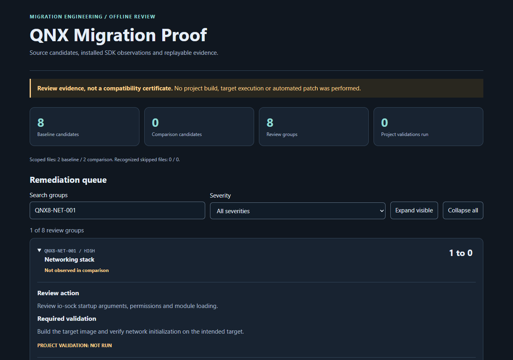

# QNX Migration Proof

**Know what broke, what changed, and what is still unverified.**

A local engineering review tool for migration from QNX SDP 7.1 to 8.0. It helps developers inspect legacy source and build configurations, connect candidates to installed SDK evidence, plan remediation, and reproduce controlled build diagnostics without confusing static analysis with runtime validation.

## See it in action

[Watch the 89-second V2 demonstration](https://youtu.be/oZo-Qxmirrg) | [Download the offline sample dashboard](https://github.com/ShenJun93/qnx-migration-proof/raw/refs/heads/main/docs/demo/review.html) | [Read the hands-on codelab](docs/CODELAB_QNX8_MIGRATION.md)

The sample is an actual generated HTML snapshot using the repository's original synthetic fixtures, with no SDK inventory or verified lab panel. Download the raw HTML file, save it as review.html, and open it in a browser. No install, account or network connection is needed after download. Try filtering by rule and expanding review tasks. The eight candidates in this sample are separate from the external benchmark below; the project validation counter is zero. The sample is not a live scan or a runtime verdict.

## Why it matters

| Evidence | Observed result |
| --- | --- |
| External repository review | 1,884 readable source/config files across four pinned repositories |
| Scanner improvement | 6 to 19 review candidates on the same checkouts |
| Real SDK experiments | 5 controlled migration pairs, 10 expected build observations |
| Reproduction | 76 automated host tests; fresh SDK lab and tamper rejection |

The additional findings include 12 deprecated C++ language-option references and one legacy ISR call. They are review locations, not 13 confirmed defects. A separate controlled QCC compile and link probe verifies the deprecation warning and a clean alternative; it does not validate an upstream application's runtime. See the [external benchmark](docs/EXTERNAL_BENCHMARK.md) for pinned sources and reproduction commands.

## Quick start (no SDK required)

Requires Python 3.10+; no Python packages or network service.

    python -m unittest discover -q
    python qnx_migration_plan.py examples/legacy --compare examples/migrated
    python qnx_review_dashboard.py examples/legacy --compare examples/migrated --output review.html

Open review.html in your browser. The examples are original synthetic illustrations, not bootable images or complete applications. Choose a new output filename.

## Real QNX build lab

On Windows with a trusted, licensed QNX SDP 8.0 installation and x86_64 target packages, run the [step-by-step codelab](docs/CODELAB_QNX8_MIGRATION.md). Tested with QNX SDP 8.0.6, GCC 12.2.0, QCC target gcc_ntox86_64 and mkifs. This is a host tool; no QEMU or target board is required for its controlled build experiments.

    $sdk = 'D:/QNX/qnx800'
    $lab = Join-Path $env:TEMP ('qnx-migration-lab-' + [guid]::NewGuid())
    python qnx_migration_lab.py run --sdk $sdk --output $lab

Retain LAB_SHA256 from the actual run. Verify with:

    python qnx_migration_lab.py verify --sdk $sdk --output $lab --expected-sha256 YOUR_RETAINED_DIGEST

Use the codelab's final exercise to create an offline dashboard combining a scan and verified lab observations.

## What the evidence means

| Controlled experiment | Before | After |
|---|---|---|
| GCC -auxbase | Compile fails | Compiles |
| Driver identity API | Strict compile fails | Compiles |
| Interrupt API | Compiles | Compiles; runtime remains unknown |
| Image data=c attribute | Warning | Clean diagnostic; identical minimal IFS |
| Legacy networking stack | Packaging fails | Packages io-sock |

These five pairs were actually built on the stated SDK; all ten observations matched expectations in fresh-checkout acceptance on November 27, 2026. The images are not bootable operating systems. No target binary was executed. Results depend on installed SDK packages and version.

A separate read-only scan of parallel public QNX 7.1/8.0 image configurations at upstream commit [d71f233](https://github.com/Deniz-Eren/workspace/tree/d71f233ffffec0db977fcbf0ba650e61de6e777b) observed 20 versus 0 candidates across 7 versus 8 recognized files. This is not a chronological migration, a project build, or a precision/recall benchmark. Upstream source is not bundled.

## Architecture

- qnx_migration_audit.py: ten documentation-backed rules and scoped coverage.
- qnx_migration_report.py: comparison and named-file SDK inventory.
- qnx_evidence_receipt.py: canonical SHA-256 receipt and scoped replay.
- qnx_migration_plan.py: review tasks and required validation.
- qnx_migration_proof.py and qnx_migration_lab.py: actual controlled QCC/mkifs experiments.
- qnx_review_dashboard.py: self-contained HTML, with optional verified lab panel.

## Boundaries

No automatic source edits, arbitrary project build execution, full C preprocessor, runtime testing, safety certification or guaranteed driver substitution. Readable recognized files only, maximum 1 MiB each; excluded and inaccessible paths limit coverage. SDK inventory is not a complete catalog. A receipt is unsigned evidence, not authenticated provenance. Verification checks local hashes and replays scoped scan/SDK observations, not a fresh build. Do not distribute SDK-derived binaries or sensitive reports. Third-party projects remain under their own licenses.

[MIT license](LICENSE) applies to this project's original code.
